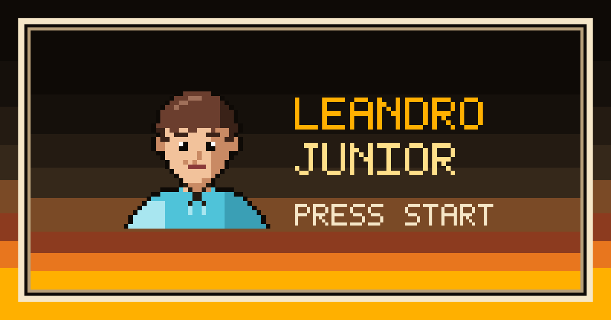

# Leandro Junior: arcade portfolio



The personal portfolio of **Leandro Junior**, a full-stack developer with a background in marketing and video. It is built as a 32-bit arcade game in modern pixel art, in the spirit of Neo Geo-era cabinets. The goal is to start SaaS partnership conversations with companies and creators, so every screen leads to the contact.

It's a single static page where each section is a game screen:

| # | Section | Game screen |
| --- | --- | --- |
| 1 | Start | Arcade boot sequence, then a title screen: a logo-styled name, an animated pixel-art developer coding at his desk, and a night skyline |
| 2 | About | Player select |
| 3 | Timeline | Career mode: stages stacked in time order |
| 4 | Skills | Inventory with an item description panel |
| 5 | Projects | Cartridge select (Lords of Logic and a "coming soon" cart) |
| 6 | Partnerships | "PLAYER 2, PRESS START" co-op screen and contact |
| 7 | Footer | Credits |

## Features

- **Arcade presentation.**
  - A fixed HUD shows the current stage.
  - A pause menu jumps to any section.
  - A skippable boot screen plays once per session.
  - Animated sprites, parallax skyline, CRT scanlines.
- **Two languages.** English at `/` and Brazilian Portuguese at `/pt-BR/`, both generated statically. Every string exists in both.
- **Two themes.** Dark by default, plus a light theme. The first visit follows `prefers-color-scheme`, and the choice is saved.
- **Optional sound.** Short menu blips synthesized with the Web Audio API. Off by default.
- **Accessible.**
  - All content is real HTML text.
  - Every text pair passes WCAG AA contrast.
  - Focus is always visible.
  - Arrow keys and Enter work in menus and grids, and everything also works by touch.
  - With `prefers-reduced-motion`, every animation and the boot screen are switched off.
- **Content-driven.** Timeline stages, skills, projects and copy live in data files. Adding a project or a skill touches no layout code.
- **No backend.** A static export hosted on Vercel, with Vercel Web Analytics.

## Tech stack

| Area | Choice |
| --- | --- |
| Framework | [Next.js](https://nextjs.org) 16 (App Router, `output: "export"`) |
| Language | TypeScript (strict) |
| Styling | [Tailwind CSS](https://tailwindcss.com) 4 with a custom token palette (`app/globals.css`) |
| Fonts | [Jersey 10](https://fonts.google.com/specimen/Jersey+10) and [Pixelify Sans](https://fonts.google.com/specimen/Pixelify+Sans) via `next/font` |
| Icons | [pixelarticons](https://github.com/halfmage/pixelarticons) (MIT) |
| Analytics | [Vercel Web Analytics](https://vercel.com/docs/analytics) |
| Hosting | [Vercel](https://vercel.com) |

## Getting started

Requirements:

- Node.js 20.9 or later, and npm.
- `npm run assets` needs Node.js 22.18 or later, because it imports TypeScript directly.

```bash
git clone https://github.com/Le-Jr/portfolio.git
cd portfolio
npm install
npm run dev
```

Open http://localhost:3000 for English and http://localhost:3000/pt-BR/ for Portuguese.

The boot screen shows once per browser session. To see it again, open a new tab or clear the `session:v1:boot-seen` key from session storage.

### Scripts

| Command | What it does |
| --- | --- |
| `npm run dev` | Starts the development server |
| `npm run build` | Builds the static site into `out/` |
| `npm run lint` | Runs ESLint |
| `npm run assets` | Regenerates `public/og.png` and the favicons from the portrait in `content/avatar.ts` |

`next start` doesn't apply to a static export. To preview a production build, serve `out/` with any static file server:

```bash
npm run build
python3 -m http.server 4173 --directory out   # or: npx serve out
```

## Project structure

```text
app/
  (en)/              English root layout and page (/)
  (pt)/pt-BR/        Portuguese page (/pt-BR/); its root layout is app/(pt)/layout.tsx
  globals.css        Palette, theme tokens, components and animations
components/          UI: HUD, boot screen, skyline, dev scene, timeline, inventory, cartridges…
content/             Site data: timeline, skills, projects, partnerships, avatar sprite
locales/             UI strings (en.ts is the reference; pt-BR.ts must match its shape)
lib/                 i18n, preferences, sound, analytics, metadata, fonts, icon registry
scripts/             build-pixel-assets.mjs (Open Graph image and favicons, no dependencies)
public/              Generated images (og.png, favicons)
docs/                Product, content and design documentation
```

## Editing content

All copy lives in `content/` and `locales/`, never in components. Localized fields are typed as `{ en: string; "pt-BR": string }`, so a missing translation fails the type check. When you change copy, update [docs/CONTENT.md](docs/CONTENT.md) too.

### Add a project cartridge

1. Add an entry to `content/projects.ts` with:
   - `kind: "released"` and a unique `id`;
   - the project URL;
   - localized genre, description and "built with".
2. Optional: give it its own label look with a `label` variant, and draw that variant in `components/cartridge.tsx`. Lords of Logic uses `"terminal"`.
3. Keep a `"coming-soon"` entry at the end, so there is always a slot for the next game.
4. Add the copy to [docs/CONTENT.md](docs/CONTENT.md).

### Add a skill item

1. Add the item to its category in `content/skills.ts`: an `id`, its name, an optional localized `usage` ("where I use it"), and an `icon`.
2. The icon is a pixelarticons glyph name. If it's a glyph the site doesn't use yet, import it in `lib/pixel-icons.ts` first.
3. Pick a glyph that hints at what the tool does. **Don't use brand logos**: most brands forbid modified logos (see [docs/ASSETS.md](docs/ASSETS.md#skill-icons)).
4. Add the item to [docs/CONTENT.md](docs/CONTENT.md) and to the mapping table in [docs/ASSETS.md](docs/ASSETS.md#mapping).

### Add a timeline stage

Add an entry to `content/timeline.ts`, in time order. Stage numbers come from the order of the list, so don't number titles by hand.

- An ongoing stage uses `to: "present"`, which shows the "NOW PLAYING" chip.
- `status: "offline"` marks a project that is no longer online.

### Replace the avatar

The portrait in `content/avatar.ts` is a 32×32 placeholder. Each character in the string map is one pixel, and the letters map to colors in `avatarColors`. After editing it, run `npm run assets` to refresh the favicons and the Open Graph image.

## Design system

The full guide is in [docs/STYLE_GUIDE.md](docs/STYLE_GUIDE.md). The short version:

- **Palette.** Closed color ramps defined as CSS variables. Components use semantic tokens (`bg-surface`, `text-primary`, `text-link`…). Tailwind's default colors are disabled.
- **Components.**
  - `.panel` and `.panel-glow` for beveled arcade panels.
  - `.arcade-button` for chunky 3D buttons.
  - `.arcade-text` for the marquee logo text.
  - `.chip` for labels.
- **Pixel art.** Integer scales only. Sprites are SVG rects with `crispEdges`.
- **Motion.** Use `steps()` timing. Every animation sits inside `prefers-reduced-motion: no-preference`.
- **Layers.** Custom CSS must live in `@layer base` or `@layer components`. Unlayered CSS overrides Tailwind utilities.

## Deployment

The site deploys to Vercel as a static export:

1. Import the GitHub repository in Vercel. It detects Next.js with no extra settings.
2. Turn on **Web Analytics** in the project dashboard.

Page views are counted on the free Hobby plan. The custom events (`start_click`, `play_click`, `contact_click`) are already wired, but Vercel only records them on the Pro plan.

Canonical and Open Graph URLs come from Vercel's built-in `VERCEL_PROJECT_PRODUCTION_URL`. No environment variables are needed.

## Documentation

| Doc | What's in it |
| --- | --- |
| [docs/PROJECT.md](docs/PROJECT.md) | Goal, audiences, sections, version 1 vs version 2, success metrics |
| [docs/CONTENT.md](docs/CONTENT.md) | Every user-facing string, in `en` and `pt-BR` |
| [docs/STYLE_GUIDE.md](docs/STYLE_GUIDE.md) | Arcade design system: palette, typography, components, motion, sound |
| [docs/ASSETS.md](docs/ASSETS.md) | Pixel-art assets, icon sources and licenses |
| [docs/ROADMAP.md](docs/ROADMAP.md) | Milestones, the time budget and the version 2 backlog |
| [docs/PLANNING.md](docs/PLANNING.md) | Original planning document (Portuguese) |
| [AGENTS.md](AGENTS.md) | Rules for coding agents working in this repo |

## Credits

- Icons: [pixelarticons](https://github.com/halfmage/pixelarticons) by Gerrit Halfmann, MIT.
- Fonts: Jersey 10 and Pixelify Sans, SIL Open Font License 1.1.
- Pixel art, sprites and generated images: original work for this site.

Technology and company names are trademarks of their owners. They are mentioned only to describe experience; no brand logos are used.

## Contact

- Email: [nascimentoleandrojr@gmail.com](mailto:nascimentoleandrojr@gmail.com)
- LinkedIn: [linkedin.com/in/leandro-jr23](https://www.linkedin.com/in/leandro-jr23)
